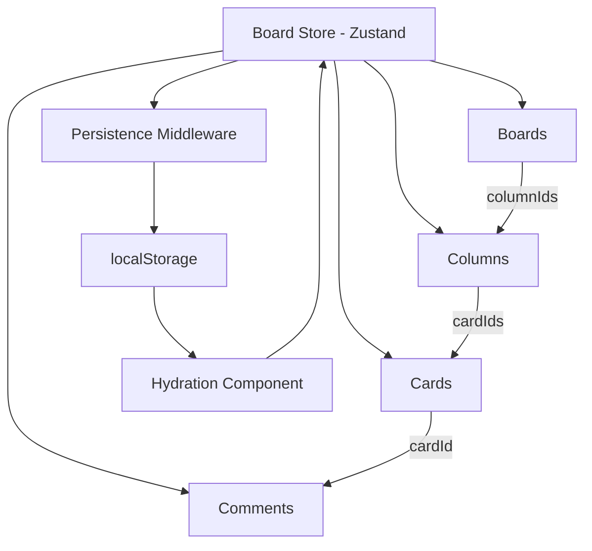

# Collabo (Collaborative Knowledge Board)

Collabo is a collaborative knowledge board for organising ideas, tasks, and milestones. Users can create boards, group work into columns, and manage cards with descriptions, tags, and due dates.

## Live Demo

[Open Collabo Board](https://collabo-board-flame.vercel.app/)

## Tech Stack

- Next.js (App Router)
- TypeScript
- Tailwind CSS
- Zustand
- Lucide React
- Vitest

## Features

- Create, edit, and delete boards.
- Create and manage custom columns.
- Create, edit, and delete cards.
- Add card descriptions, tags, and due dates.
- Move and reorder cards between columns.
- Add threaded comments to cards.
- Edit and delete comments.
- Undo and redo supported actions.
- Persist board data using localStorage.
- Simulated cross-tab collaboration.

## Getting Started

Install dependencies:

```bash
pnpm install
```

Start the development server:

```bash
pnpm dev
```

Open [http://localhost:3000](http://localhost:3000) in your browser.

## Available Scripts

| Command                  | Description                  |
| ------------------------ | ---------------------------- |
| `pnpm dev`               | Start the development server |
| `pnpm build`             | Build the application        |
| `pnpm start`             | Start the production server  |
| `pnpm lint`              | Check for linting issues     |
| `pnpm test`              | Run automated tests          |
| `pnpm exec tsc --noEmit` | Check TypeScript types       |

## Project Structure

- `src/app/` — Dashboard, board pages, and application layouts.
- `src/components/` — Reusable components and providers.
- `src/lib/` — API abstraction and collaboration utilities.
- `src/stores/` — Zustand store and state actions.
- `src/types/` — TypeScript types for boards, columns, cards, and comments.

## State Management

I used Zustand to manage the shared board data. Boards, columns, cards, and comments are stored separately and linked by IDs, making individual items easier to update and delete.

The store handles CRUD operations, card movement, threaded comments, and undo/redo history. Zustand persistence middleware saves board data to `localStorage`, while a separate hydration component loads the saved data in the browser.

### State Architecture



## Collaboration

Collabo uses an API abstraction to handle board mutations and BroadcastChannel to communicate updates between browser tabs.

The current implementation simulates collaboration across tabs within the same browser origin. It does not yet provide a production backend or persistent synchronisation across different devices.

## Accessibility and Performance

The interface includes keyboard and focus handling for the dashboard dialog, accessible labels, and visible focus styles.

The normalised state keeps data organised, while Zustand subscriptions let components access the state they need without subscribing to the entire store unnecessarily.

## Testing

The project uses Vitest for automated testing.

Run the test suite:

```bash
pnpm test
```

Check TypeScript:

```bash
pnpm exec tsc --noEmit
```

Check linting:

```bash
pnpm lint
```
