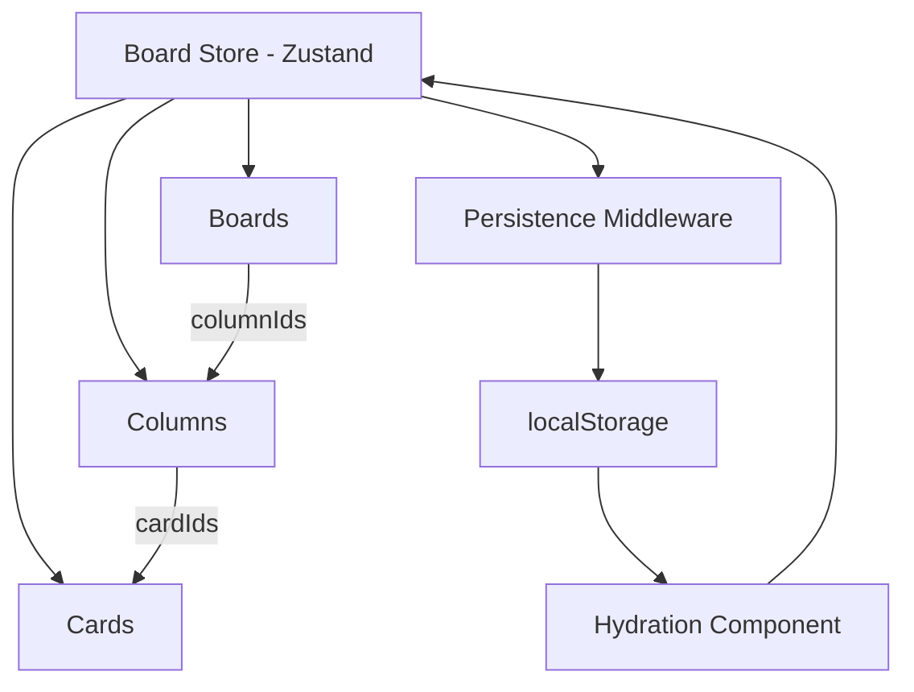

# Collabo (Collaborative Knowledge Board)

Collabo is a TGR Stage 1 project for organising ideas, tasks, and milestones. Users can create boards, group work into columns, and manage cards with descriptions, tags, and due dates.

## Live Demo

[Open Collabo Board](https://collabo-board-flame.vercel.app/)

## Tech Stack

- Next.js (App Router)
- TypeScript
- Tailwind CSS
- Zustand
- Lucide React

## Getting Started

Install dependencies and start the development server:

```bash
pnpm install
pnpm dev
```

Open [http://localhost:3000](http://localhost:3000) in your browser.

To check for linting issues, run:

```bash
pnpm lint
```

## Project Structure

- `src/app/` — dashboard and board pages
- `src/components/` — reusable components and providers
- `src/stores/` — Zustand store and state actions
- `src/types/` — TypeScript types for boards, columns, and cards

## State Management

I used Zustand to manage the shared board data. Boards, columns, and cards are stored separately and linked by IDs, making individual items easier to update and delete.

The store handles the main CRUD operations, while persistence middleware saves board data to `localStorage`. A separate hydration component loads the saved data in the browser.

### State Architecture



## Accessibility and Performance

The interface includes keyboard and focus handling for the dashboard dialog, accessible labels, and visible focus styles. The normalised state keeps data organised, while Zustand subscriptions let components access the state they need.

## Future Improvements

Possible next steps include adding a backend, user authentication, real-time collaboration, and automated tests.
